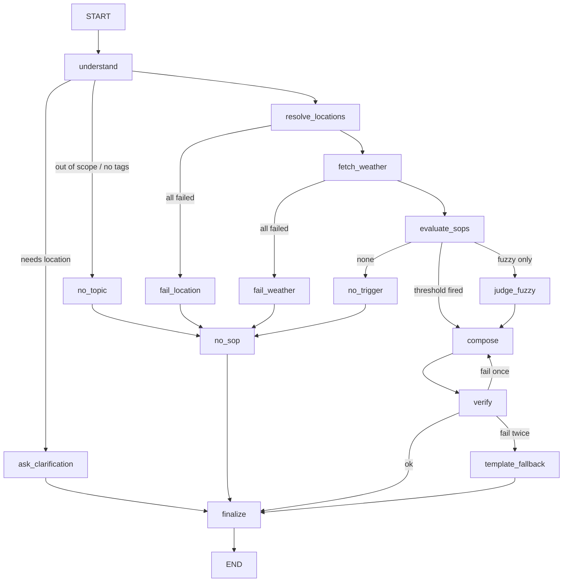

# SOP Weather Safety Chatbot

Minimal **FastAPI + LangGraph (Python)** assistant: live weather from [Open-Meteo](https://open-meteo.com/), safety rules in **YAML SOPs** (re-loaded every request), LLM only for language and structured extraction — not facts or policy.

## Setup

```bash
cd MediBuddy
python3 -m venv .venv
source .venv/bin/activate   # Windows: .venv\Scripts\activate
pip install -r requirements.txt
cp .env.example .env          # set OPENAI_API_KEY and MODEL (e.g. gpt-4o-mini)
```

## Run (API + chat UI)

```bash
source .venv/bin/activate
python -m src.server
# or: uvicorn src.server:app --host 0.0.0.0 --port 8000
```

Open `http://localhost:8000/` — static chat UI posts to `POST /chat` with `{ sessionId, message }` (max 500 chars).

## Evals

```bash
source .venv/bin/activate
python evals/run.py
```

Writes `evals/RESULTS.md` (PASS / FAIL / SKIPPED with notes).

## SOP format (one YAML file per rule)

Human-editable thresholds and pre-authored guidance (no digits in `guidance`; numbers live in `when`). Invalid files are **skipped**, logged, and listed in `trace.skippedSops`. **Add or change policy by dropping/editing a file in `sops/` — no server restart.**

See example in `sops/SOP-003-gusts-two-wheeler.yaml`.

## Architecture



| Branch | Why |
|--------|-----|
| `ask_clarification` | No geocodable location in message or session |
| `no_topic` | Not weather-safety scoped |
| `fail_location` / `fail_weather` | No forecast → honest reply, **no LLM compose** |
| `no_trigger` | In scope but no SOP conditions met |
| `judge_fuzzy` | LLM picks verdict key only; code applies vetoes + guidance text |
| `verify` / `template_fallback` | Enforces {{F#}} grounding; fallback is deterministic |

## Deterministic vs LLM

| Step | Who decides |
|------|-------------|
| Tag vocabulary, thresholds, firing, supersedes, ranking | Code (`src/sops.py`) |
| Geocode + Open-Meteo | Code (`src/weather.py`) |
| Facts table, footer, digit/SOP verifier | Code (`src/grounding.py`) |
| Intent, tags, locations, time window | LLM structured output (`understand`) |
| Wording of answer | LLM (`compose`) from SOP guidance + {{F#}} |
| Fuzzy verdict key | LLM; guidance text from YAML |

## Non-negotiables (enforcement)

1. **Traceable SOP or explicit none** — footer built in `grounding.build_footer()` inside `finalize_node`; never in prompts.
2. **SOPs = YAML only** — no SOP ids/tags/thresholds in application logic; `load_sops()` each turn in `understand`.
3. **No forecast → no invented weather** — `fail_weather` / `fail_location` before compose.
4. **No trigger → no invented advice** — `no_trigger` template in `no_sop_node`.
5. **Numbers from API** — facts table + `verify_composed_text()` in `grounding.py`.
6. **LangGraph + checkpointer** — `MemorySaver`, `thread_id = sessionId` in `graph.build_graph()`.

## Conflict rule

When multiple SOPs fire: apply `supersedes`, sort by severity (critical → info), tie-break **global (`*`) first**, then id; show up to **three**, lead with highest; footer lists all cited. Rationale: hiding lower-severity risks (e.g. UV + gusts for cycling) is worse than a ranked, short answer.

## Global severe weather

Open-Meteo has no named “weather system” field. **SOP-001** uses proxies: heavy 24h rain sum, severe WMO `weather_code`, and `pressure_msl` delta — documented here and in SOP guidance.

## Prompt injection & number spoofing

User text is delimited and marked untrusted; the model is instructed not to obey override requests. **Enforcement** is primarily: deterministic firing from API data, no digits in LLM output except `{{F#}}`, footer from code, and no SOP-099 in YAML. Residual risk: spelled-out numbers (not verified) and extraction mistakes — see gaps.

## Known gaps

- New **metrics** in YAML work via union fetch; new **data sources** (e.g. AQI) or **operators** need code.
- Geocoding uses **first** search hit (ambiguity visible in trace).
- Low-pressure / “severe regime” is a **proxy**.
- **Spelled-out numbers** in compose are not caught by verifier.
- LLM may mis-tag; evals note flakiness.
- Live severe eval (6) is **SKIPPED** when the day is mild; mock + oracle tests cover logic.

## After the storm passes (eval 6)

Use the same pattern as tests 1–5 and 16: `make_weather()` fixtures + oracle `evaluate_sops_for_request()` on identical payload — already in `evals/run.py`. Live check remains an optional sanity test.

## Adding SOP 11+

Add `sops/SOP-0XX-your-rule.yaml`, valid schema, reload on next chat message — no redeploy step beyond file save.
